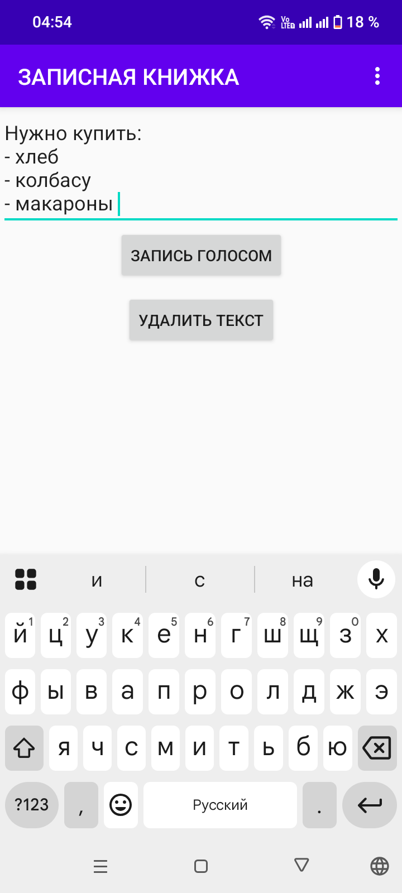
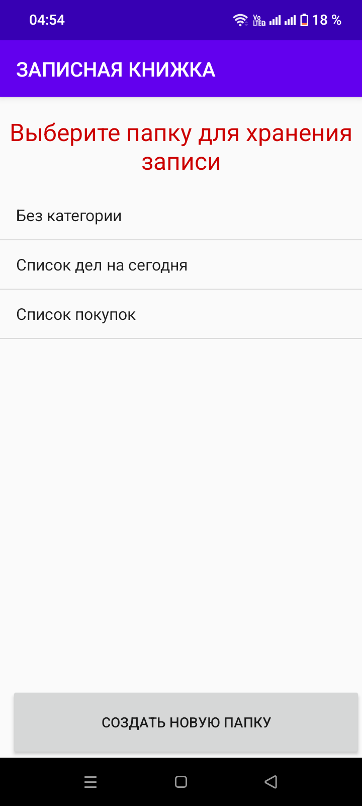
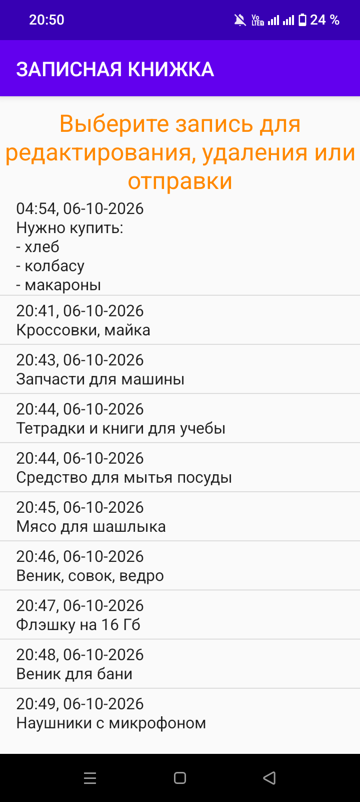
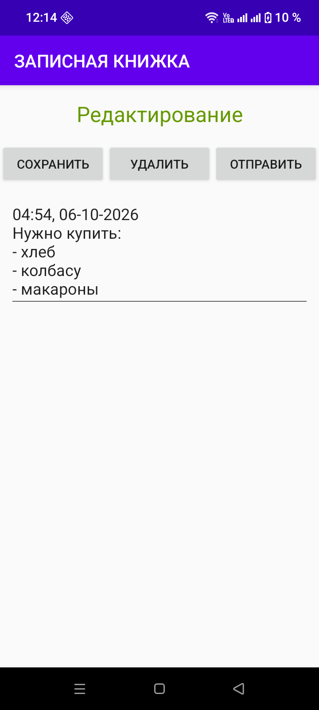

# 📝 Записная книжка

---

### 📊 Статус проекта:
✅ **Полный функционал** — заметки создаются, редактируются и удаляются  
✅ **Локальное хранение** — данные сохраняются в SQLite на устройстве  
✅ **Готов к использованию** — можно вести личные записи  

---

### 🎯 Что сделано:
- Android-приложение для ведения заметок и списков
- Создание текстовых записей с автоматической датой и временем
- Разбиение записей по папкам-категориям
- Создание собственных папок («Создать новую папку»)
- Просмотр всех записей с датой и временем
- Редактирование, удаление и отправка записи
- Запись голосом (распознавание речи)
- Все данные хранятся локально в SQLite (без интернета)

---

### 🏗 Архитектура проекта

Приложение разделено на **3 логических модуля**:

#### ✏️ Создание записи
Ввод текста заметки, запись голосом, удаление текста.

#### 📁 Выбор папки
Сохранение записи в одну из папок: «Без категории», «Список дел на сегодня», «Список покупок» или во вновь созданную пользователем папку.

#### 📋 Просмотр и редактирование
Список всех записей с датой и временем. 
---

### 🛠️ Технологии:

| Компонент | Технологии |
|-----------|------------|
| **Язык** | Java |
| **Платформа** | Android (API 17+) |
| **Хранение данных** | SQLite (`SQLiteOpenHelper`) |
| **Распознавание речи** | Android Speech Recognizer |

---

### 📸 Галерея скриншотов

#### 🏠 Главный экран и работа с записями

👉 Нажмите, чтобы развернуть скриншоты

 

| Создание записи | Выбор папки | Список записей | Редактирование |
| :---: | :---: | :---: | :---: |
|  |  |  |  |

---

### 📌 О проекте

> Проект разработан как портфолио-решение для демонстрации навыков разработки под **Android на Java**. Показывает работу с локальной базой данных SQLite, навигацией между Activity, обработкой списков, распознаванием речи, диалоговыми окнами и редактированием записей.

---

### 📝 Лицензия

MIT. Свободное использование в образовательных целях.
